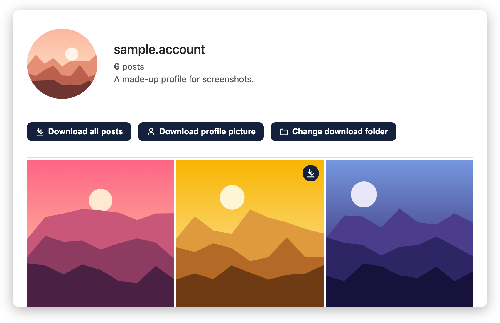

# Instagram Downloader Chrome Extension 📸

Ever wanted to keep that photo, reel or story before it vanishes into the algorithm? This Chrome extension sticks a little download button on pretty much everything Instagram shows you. Photos, videos, carousels, stories, highlights, a whole account, even every account you follow. Yes, all of them. 🙃



## What you get ⬇️

| Where you are                            | What shows up                                                                                                        |
| ---------------------------------------- | -------------------------------------------------------------------------------------------------------------------- |
| Feed posts, post and reel pages          | A download button next to the bookmark. On a carousel it grabs the slide you're on, and a second one grabs them all. |
| Profile, explore, saved and tagged grids | A tiny button in the corner of each thumbnail that saves the whole post.                                             |
| Someone's profile                        | **Download all posts**, **Download profile picture** and **Change download folder**.                                 |
| Your own profile                         | **Download following**, which archives everyone you follow. Go make a cup of tea. ☕                                 |
| The story viewer                         | **Download this story** and **Download all**, for stories and highlights.                                            |

Most single downloads don't cost a request at all. The page script just reads the post and story data Instagram already sent to draw the page. Sneaky. 🕵️

## Slow and steady 🐢

Bulk downloads take their time, on purpose, because nobody wants an angry Instagram. Every API call waits a random 4 to 9 seconds, so the pace stays steady rather than racing and then resting. A page of posts is one call, which works out at roughly 550 calls, or about 6,600 posts, an hour. There's a ceiling of 600 calls in any hour as a backstop. If Instagram says no, it backs off for 15, 30, 60 and then 120 minutes, counting down as it goes, before giving up for the day.

Hit Stop whenever you like: it remembers where it got to and the button turns into **Resume**. An account you've fully archived before is only read until it reaches posts you already have. Want to fiddle with the numbers? They live in [`src/content/pacing/pacing.ts`](src/content/pacing/pacing.ts).

## Install it 🔧

You need [Node.js](https://nodejs.org) 22 or newer, and a recent Chrome.

1. Grab the code and build it:

   ```bash
   git clone https://github.com/christianjbrown/chrome-extension-instagram-downloader.git
   cd chrome-extension-instagram-downloader
   npm ci
   npm run build
   ```

   That makes a `dist` folder, which is the actual extension.

2. Open `chrome://extensions` in Chrome.
3. Flip on **Developer mode** (top right).
4. Click **Load unpacked** and pick the `dist` folder.
5. Reload any Instagram tab you already had open.

### Updating 🔄

```bash
git pull
npm ci
npm run build
```

Then hit the reload arrow on the Christian's Instagram Downloader card in `chrome://extensions`, and reload Instagram.

## Good to know 🤓

- **Single downloads land in Chrome's usual download folder.** No questions asked.
- **Bulk downloads ask you for a folder,** once per tab (it forgets when you close the tab, on purpose). Each account goes in `<folder>/<username>/`, and anything already there is skipped, so running one again only fetches what's new. The panel shows which post it's on out of the account's total, with a progress bar, plus a second bar for the whole run when you're grabbing everyone you follow. 📊 Finding the total costs one extra call per account unless Instagram already sent it, and reruns that only look for new posts skip it.
- **It asks for one permission,** `storage`, which is where a stopped bulk run keeps its place so **Resume** can carry on. That's your following list and when each account was last finished, on your machine only.
- **It only runs on `www.instagram.com`,** so Chrome will say it can read and change your data there, and that's the whole list.

## No tracking 🔒

No analytics, no tracking, no ads, no accounts, and nothing phoning home. The only things it ever fetches come from Instagram itself: the posts you asked for and the photos and videos in them. Files go straight into the folder you picked, and nothing about what you download goes anywhere else.

## Development 🛠️

It's TypeScript, bundled with esbuild, tested with Vitest.

```bash
npm test          # the unit tests
npm run ci        # everything CI checks: format, lint, types, unused code, 100% coverage, build
```

`npm run ci` is exactly what CI runs, and coverage has to stay at 100% for lines, branches, functions and statements, or it fails. To run it before every push, point git at the committed hook: `git config core.hooksPath .githooks`.

How it fits together, all in `src`:

- **`page/`** lives inside Instagram's own page (`world: MAIN`). It reads the JSON Instagram's requests come back with, caches any media it spots, and runs Instagram's own Relay queries for anything it hasn't seen yet.
- **`content/`** lives in the extension's isolated world. It adds the buttons, asks the page script for media over a `MessageChannel`, paces the bulk runs, and saves the files.
- **`shared/`** is the protocol and media model both sides agree on. Lint keeps the three apart: page and content never import each other's code.

Every class gets its collaborators through its constructor, and only the two `start*` functions build anything, so each piece is tested on its own with fakes. 🧩

## Licence 📄

MIT. See [LICENSE](LICENSE).
